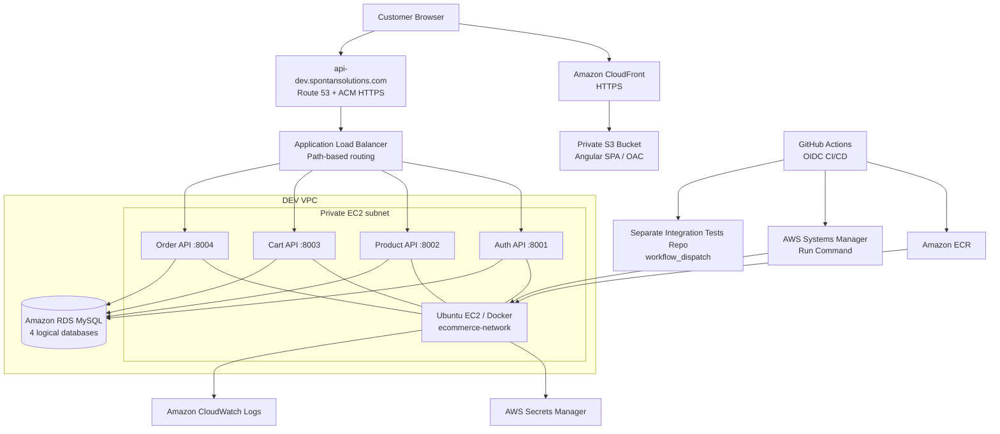

# AWS DevOps eCommerce Platform — DEV Environment

A portfolio implementation of an Angular storefront and four Python/FastAPI microservices deployed on AWS, with automated build, security scanning, deployment, and post-deployment integration testing.

> **Scope:** This repository documents the **DEV environment**, not a production-ready highly available deployment. Some implementation details are intentionally omitted or marked for verification before publishing.

## Architecture

*Diagram is conceptual; networking and IAM controls are described in `docs/DEV-INFRASTRUCTURE.md`.*

## Application components

| Component | Technology | DEV deployment |
|---|---|---|
| Storefront | Angular standalone SPA | Amazon S3 + CloudFront with OAC |
| Auth service | FastAPI / Python | Docker container on private EC2, port 8001 |
| Product service | FastAPI / Python | Docker container on private EC2, port 8002 |
| Cart service | FastAPI / Python | Docker container on private EC2, port 8003 |
| Order service | FastAPI / Python | Docker container on private EC2, port 8004 |
| Persistence | MySQL | Amazon RDS, separate logical DBs per service |
| Container registry | Docker images | Amazon ECR |

## DEV delivery workflow

1. A change is merged into the service's `develop` branch.
2. GitHub Actions installs dependencies and executes Python unit tests.
3. Trivy scans the source filesystem for high/critical findings.
4. CI builds a Docker image tagged with the short commit SHA and pushes it to Amazon ECR.
5. A reusable CD workflow assumes an AWS IAM role using GitHub OIDC and runs an SSM command on private EC2.
6. The command loads runtime configuration from Secrets Manager, applies Alembic migrations where configured, replaces the service container, and checks the service health endpoint.
7. After deployment, a GitHub App installation token triggers the integration-test workflow in a separate repository.

**Important:** The DEV service pipelines currently **dispatch** integration tests; they do **not** wait for the remote workflow's pass/fail result. The integration-test repository reports its own results.

## Environment endpoints

- Storefront: https://shop-dev.spontansolutions.com
- API: https://api-dev.spontansolutions.com

These are DEV endpoints and may be unavailable when the environment is stopped to control costs.

## Security and operational practices

- GitHub Actions authenticates to AWS using OIDC rather than long-lived AWS access keys.
- The application host resides in a private subnet; AWS Systems Manager is used for remote deployment.
- Application secrets are retrieved from AWS Secrets Manager at deployment time and placed in a restricted local environment file (`chmod 600`).
- CloudFront serves the SPA over HTTPS; ALB redirects HTTP to HTTPS for API access.
- CloudWatch captures application logs; deployment scripts perform health checks.
- ECR image tags reference source commits, enabling deployment traceability.

## Design boundaries / future work

This DEV implementation intentionally uses **one EC2 instance for four containers** and does not claim multi-AZ application high availability, automated rollback, complete GitOps, infrastructure-as-code, or automated gating on integration-test outcomes. STAGING/PROD, release approvals, comprehensive alerting and HA/DR are planned extensions.

## Documentation

- [DEV Infrastructure](docs/DEV-INFRASTRUCTURE.md)
- [CI/CD Pipeline](docs/CI-CD-PIPELINE.md)
- [Resume-ready project description](docs/RESUME-PROJECT.md)
- [Architecture diagram source](docs/architecture.mmd)

## Screenshots to add

For a stronger portfolio, add **redacted** screenshots of: GitHub Actions successful job graph, integration-test workflow result, ALB listener rules, CloudFront distribution, CloudWatch logs, and an application screenshot. Do not publish account IDs, instance IDs, secrets, tokens, RDS endpoints, private addresses or sensitive logs.
