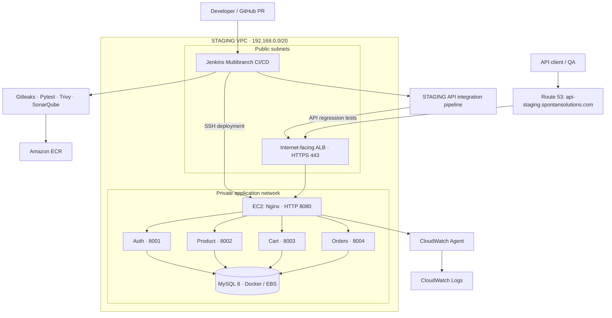
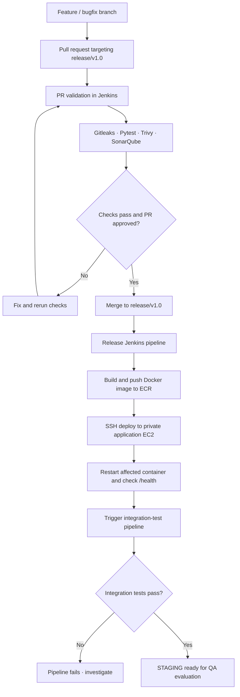

# AWS eCommerce Platform — STAGING Environment

   

> **Portfolio project:** A pre-production AWS environment for validating containerized eCommerce microservices before production promotion.
>
> **Region:** `us-east-1` | **Status:** Backend deployment, Jenkins release pipelines, API integration tests, and Docker log shipping verified as of October 2026.

[← Infrastructure repository](https://github.com/kosaraju3333/aws-devops-ecommerce-infrastructure/tree/master)

## 1. Overview

This STAGING environment hosts an eCommerce application built with **Angular**, four independently deployable **Python FastAPI** services (**Auth**, **Product**, **Cart**, and **Orders**), and **MySQL 8**. It provides an isolated AWS network, automated Jenkins multibranch CI/CD, pull-request validation, vulnerability and secret scanning, post-deployment health checks, API integration tests, and centralized Docker logging.

**Scope:** This README documents the STAGING backend and deployment pipeline. STAGING-specific Angular frontend hosting and automated browser E2E tests have **not** been independently verified. QA sign-off, immutable image promotion, and formal code-freeze controls are described as planned improvements, not completed automation.

## 2. Architecture



> **Deployment detail:** The latest observed STAGING host runs Nginx, four application containers, and a `mysql_c1` container. The MySQL data directory is backed by EBS. The original design considered an internal ALB, but the implemented API entry point uses an **internet-facing ALB** with Nginx behind it.

### Request path

```text
Client → Route 53 → ALB (HTTPS :443) → Nginx (HTTP :8080)
                                             ├── Auth     :8001
                                             ├── Product  :8002
                                             ├── Cart     :8003
                                             └── Orders   :8004
```

TLS terminates at the ALB. Nginx proxies to the local FastAPI container ports. The ALB-to-Nginx and Nginx-to-service hops use HTTP within the AWS network; these are **not end-to-end encrypted** in the documented implementation.

## 3. AWS Infrastructure

| Component | STAGING implementation |
|---|---|
| AWS Region | `us-east-1` |
| VPC | `192.168.0.0/20` |
| Networking | Public/private subnets, Internet Gateway, NAT Gateway, route tables |
| Public entry point | Route 53 DNS + internet-facing ALB, HTTPS 443 |
| CI/CD | Jenkins on public-subnet EC2 |
| Application | Private EC2 with Nginx and Docker containers |
| Database | MySQL 8 Docker container, EBS-backed persistent data |
| Container registry | Amazon ECR |
| IAM | EC2 instance roles; STAGING app role `ecommerce-staging-ec2-role` |
| Logging | CloudWatch Agent → CloudWatch Logs |

The private application network uses NAT for outbound access. Security groups restrict inbound traffic; export and review the exact rules before treating this documentation as an infrastructure security audit.

## 4. Application Services and Routing

| Service | Container name | Port | Public API prefix | Health endpoint |
|---|---|---:|---|---|
| Auth | `ecommerce-auth-staging` | 8001 | `/api/auth/` | `/api/auth/health` |
| Product | `ecommerce-product-staging` | 8002 | `/api/products/` | `/api/products/health` |
| Cart | `ecommerce-cart-staging` | 8003 | `/api/cart` | `/api/cart/health` |
| Orders | `ecommerce-order-staging` | 8004 | `/api/orders/` | `/api/orders/health` |

**API base URL:** `https://api-staging.spontansolutions.com`

Nginx has explicit health-check mappings so that `/api/<service>/health` is proxied to the corresponding service's `/health` endpoint.

Example validation:

```bash
for service in auth products cart orders; do
  curl -fsS "https://api-staging.spontansolutions.com/api/${service}/health"
  echo
done
```

## 5. Git Workflow and CI/CD

The backend services have separate GitHub repositories and Jenkins multibranch pipelines. STAGING deployments run from `release/v1.0` branches. PR builds and release branch builds follow different paths.



### CI/CD responsibilities

**PR validation:**

- **Gitleaks:** checks for accidentally committed secrets.
- **Pytest:** runs service-level Python tests.
- **Trivy:** scans dependencies and/or container artifacts for vulnerabilities, according to each service's Jenkinsfile.
- **SonarQube:** runs static analysis and configured quality checks; edition-dependent PR-analysis limitations apply.

**Release deployment:**

1. Jenkins builds a service-specific Docker image.
2. The image is pushed to **Amazon ECR**.
3. Jenkins connects to the private application EC2 using SSH over private networking.
4. The affected container is replaced with the newly built image.
5. Jenkins validates the service health endpoint.
6. Jenkins triggers the separate STAGING API integration-test pipeline and propagates its result.

This is a container-replacement deployment, **not** a zero-downtime rolling or blue/green deployment.

## 6. Post-Deployment Integration Tests

A dedicated Jenkins multibranch job, **`ecommerce-integration-tests-staging`**, runs API integration tests against the deployed STAGING environment. **10 tests were reported passing**.

Example downstream stage from a service Jenkinsfile:

```groovy
stage('Release - STAGING Integration Tests') {
    when {
        allOf {
            not { changeRequest() }
            expression { return env.BRANCH_NAME?.startsWith('release/') }
        }
    }
    steps {
        build job: 'ecommerce-integration-tests-staging/release%2Fv1.0',
              wait: true,
              propagate: true
    }
}
```

`wait: true` waits for the downstream job; `propagate: true` fails the upstream pipeline when integration tests fail. API integration testing is distinct from Angular unit tests and browser-driven end-to-end testing.

## 7. MySQL Persistence

- Database engine: **MySQL 8** in Docker (`mysql_c1`).
- Service databases: `ecommerce_auth`, `ecommerce_products`, `ecommerce_cart`, `ecommerce_orders`.
- Persistent storage: an attached **EBS volume**, mounted at `/data/mysql` and bind-mounted into the MySQL container's data directory.
- Goal: retain database files when the MySQL container is recreated.

**Operational note:** An EBS bind mount is persistence, not a complete backup or high-availability strategy. Automated backups, tested restores, RPO/RTO targets, and failover remain future work.

## 8. CloudWatch Logging

The **Amazon CloudWatch Agent** collects Docker `json-file` logs from the STAGING application EC2. Log delivery was verified after troubleshooting the agent configuration and AWS connectivity.

| Setting | Value |
|---|---|
| Log group | `/ecommerce/staging/docker` |
| Log source | `/var/lib/docker/containers/*/*-json.log` |
| Log stream | `{instance_id}` |
| EC2 role | `ecommerce-staging-ec2-role` |
| Region | `us-east-1` |
| Nginx log collection | **Not enabled** (intentionally skipped) |

Example CloudWatch Agent configuration:

```json
{
  "agent": { "run_as_user": "root" },
  "logs": {
    "logs_collected": {
      "files": {
        "collect_list": [
          {
            "file_path": "/var/lib/docker/containers/*/*-json.log",
            "log_group_name": "/ecommerce/staging/docker",
            "log_stream_name": "{instance_id}"
          }
        ]
      }
    }
  }
}
```

Keep the **source configuration** at `/opt/aws/amazon-cloudwatch-agent/etc/amazon-cloudwatch-agent.json`, outside the agent-managed `amazon-cloudwatch-agent.d/` directory. Load it with:

```bash
sudo /opt/aws/amazon-cloudwatch-agent/bin/amazon-cloudwatch-agent-ctl \
  -a fetch-config -m ec2 \
  -c file:/opt/aws/amazon-cloudwatch-agent/etc/amazon-cloudwatch-agent.json \
  -s
```

Verify:

```bash
sudo /opt/aws/amazon-cloudwatch-agent/bin/amazon-cloudwatch-agent-ctl -m ec2 -a status
aws logs describe-log-groups \
  --region us-east-1 \
  --log-group-name-prefix '/ecommerce/staging/docker'
```

**Current limitations:** All matching Docker logs (potentially including MySQL) share a log group and stream. Per-service log streams, retention settings, structured application logging, and sensitive-data filtering should be added. Do not log credentials, JWTs, or customer information.

## 9. Security Controls

- **Private application subnet:** Backend EC2 is not directly internet-facing.
- **HTTPS entry point:** Public ALB terminates TLS using an AWS certificate.
- **IAM roles:** AWS permissions are provided through instance roles rather than hard-coded access keys.
- **PR validation:** Gitleaks, Pytest, Trivy, and SonarQube checks run before release merges.
- **Restricted deployment access:** Jenkins deploys over SSH to private EC2; limit SSH to authorized sources.
- **Operational hygiene:** Keep secrets outside source control and sanitize logs and published screenshots.

Security scans reduce risk but do not establish that the environment is fully hardened or compliant.

## 10. Operational Verification

Use these checks during deployments and incident triage:

```bash
# Containers and their state
sudo docker ps

# Service logs
sudo docker logs --tail 50 ecommerce-auth-staging

# Nginx configuration
sudo nginx -t
sudo systemctl status nginx --no-pager

# Local health check
curl -fsS http://127.0.0.1:8001/health

# CloudWatch Agent status
sudo systemctl status amazon-cloudwatch-agent --no-pager

# CloudWatch Agent delivery diagnostics
sudo tail -50 /opt/aws/amazon-cloudwatch-agent/logs/amazon-cloudwatch-agent.log
```

Also confirm ALB target health, successful Jenkins release and downstream integration builds, ECR image references, and database persistence after container recreation.

## 11. Troubleshooting Experience

| Problem | Investigation / resolution |
|---|---|
| ALB/Nginx health routes failed | Configured exact-match Nginx locations mapping `/api/<service>/health` to `/health`. |
| PR builds did not trigger consistently | Reviewed GitHub webhook content type and Jenkins Git Branch Source discovery. |
| Private DB DNS resolution failed | Corrected Route 53 private hosted-zone VPC association and VPC DNS settings. |
| CloudWatch log group missing | Verified EC2 IAM role, `sts get-caller-identity`, endpoint reachability, and agent configuration. |
| CloudWatch Agent config filename changed | Avoided reloading generated `file_`-prefixed files from the managed directory; retained a separate source JSON. |
| Historical CloudWatch errors appeared | Distinguished old `/ecommerce/dev/docker` errors from the active STAGING log configuration. |

## 12. Release Management and Promotion

**Implemented:** STAGING release branches, Jenkins release deployments, service health checks, and downstream API integration tests.

**Planned controls (not yet verified as enforced):**

1. Freeze the approved `release/v1.0` code state using GitHub branch rules.
2. Record QA approval (+1) and test evidence.
3. Tag approved commits and record exact ECR image digests for all services.
4. Promote the **same approved image digests** to PROD instead of rebuilding.
5. Maintain rollback procedures and deployment audit records.

## 13. Next Improvements

- CloudWatch alarms for CPU, memory, disk, API error rates, and latency.
- Separate service log streams, log retention policies, and sensitive-data redaction.
- Automated database snapshots and restore drills.
- Immutable image-digest promotion with explicit QA approval.
- Application health dashboards, alert routing, and rollback automation.
- STAGING frontend hosting verification and browser-based E2E tests.
- Infrastructure as Code (Terraform) for reproducible STAGING environments.
- Stronger availability patterns for production (multiple application instances, managed database, and orchestrated deployments).

## 14. Resume-Ready Project Description

> Designed and deployed an AWS STAGING environment for a containerized eCommerce platform using VPC, EC2, ALB, Nginx, Docker, ECR, MySQL, and CloudWatch. Implemented Jenkins multibranch CI/CD with pull-request validation using Gitleaks, Trivy, SonarQube, and Pytest; automated service deployment and health checks; integrated a dedicated API regression pipeline with 10 passing tests; and centralized Docker logs in Amazon CloudWatch.

## 15. Suggested GitHub Evidence

Add sanitized artifacts under `staging/` as you capture them:

```text
staging/
├── README.md
├── diagrams/
│   └── staging-architecture.png      # optional exported diagram
├── screenshots/
│   ├── jenkins-pr-validation.png
│   ├── jenkins-release-pipeline.png
│   ├── integration-tests.png
│   └── cloudwatch-log-group.png
└── configs/
    ├── nginx-staging.example.conf
    └── cloudwatch-agent.example.json
```

> **Before publishing:** Remove account-specific secrets, private keys, credentials, customer data, internal-only endpoints, and sensitive log lines from screenshots and configuration examples.

---

**Related environments:** [DEV](../dev/README.md) · STAGING (this document) · [PRODUCTION](../production/README.md) *(links will work after those files are added)*
